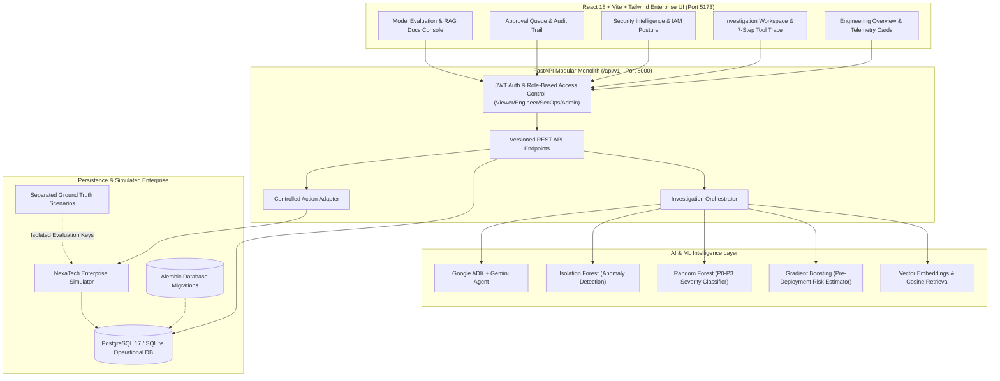

# AI Engineering Operations Agent with AI Security Engineering & Security Intelligence

[](.github/workflows/ci.yml)
[](https://fastapi.tiangolo.com)
[](https://react.dev)
[](https://www.python.org)
[](https://www.postgresql.org)
[](https://aistudio.google.com/)

An enterprise-grade, autonomous platform designed for small engineering teams to investigate software operations and security incidents. It combines **Machine Learning for operational anomaly detection**, **Gemini and Google Agent Development Kit (ADK) for tool-using investigations**, **vector embeddings retrieval (RAG)** over runbooks, and **human-in-the-loop controlled remediation** with post-action verification.

---

## Table of Contents
1. [Architecture Overview](#1-architecture-overview)
2. [NexaTech Enterprise Simulator & Evaluation Scenarios](#2-nexatech-enterprise-simulator)
3. [Machine Learning Pipelines](#3-machine-learning-pipelines)
4. [Google ADK & Gemini Agent Orchestration](#4-google-adk--gemini-agent-orchestration)
5. [Security Intelligence & Controlled Remediation](#5-security-intelligence--controlled-remediation)
6. [Role-Based Access Control (RBAC)](#6-role-based-access-control-rbac)
7. [Quickstart & Local Installation](#7-quickstart--local-installation)
8. [Automated Verification & Testing](#8-automated-verification--testing)
9. [Docker & Cloud Run Deployment](#9-docker--cloud-run-deployment)
10. [API Reference Summary](#10-api-reference-summary)

---

## 1. Architecture Overview

The system is constructed as a **modular monolith** with clean boundaries between domain models, ML estimators, RAG ingestion, agent tool adapters, and web interfaces.



### High-Level Operational Flow
$$\text{Dashboard} \longrightarrow \text{Authenticated API} \longrightarrow \text{Investigation Service} \longrightarrow \text{Agent Orchestrator} \longrightarrow \text{Validated Tools} \longrightarrow \text{ML / RAG / DB} \longrightarrow \text{Evidence-Backed Findings} \longrightarrow \text{Approval Workflow} \longrightarrow \text{Controlled Action} \longrightarrow \text{Verification} \longrightarrow \text{Audit Trail}$$

---

## 2. NexaTech Enterprise Simulator

To provide realistic operational telemetry before live third-party enterprise integrations are configured, the repository includes a reproducible fictional company simulator named **NexaTech Enterprise**.

### Relational Entity Graph
- **Teams & Users**: Core Platform, Payments & Billing, Identity & Security, Order & Fulfillment.
- **Microservices**: `payments-service` (Tier-1), `auth-service` (Tier-1), `order-processing` (Tier-2), `notification-service` (Tier-3), `catalog-service` (Tier-2).
- **Code Artifacts**: Git repositories, commits, pull requests (`#412`), and diff stats.
- **Deployments**: Version tags (`v2.4.1`, `v2.4.2`, `v3.1.0-rc1`), environment targets (`production`, `canary`), rollback targets.
- **Observability**: Error rate time series, p50/p95/p99 latency percentiles, CPU/memory usage, DB query latency, and correlated trace logs.
- **Security & IAM**: CVE records with CVSS scores (`CVE-2024-21626`), exploitability flags, and suspicious IAM events outside VPC subnets.
- **Runbooks & Postmortems**: Chunked operational markdown documents for RAG grounding.

### Ground-Truth Evaluation Scenarios
| Scenario ID | Name | Core Symptoms | Expected Ground Truth | Remediation Action |
|---|---|---|---|---|
| **Scenario A** | Payments Deployment Regression | 5xx error spike (18.5%), DB deadlocks | PR #412 locking hints in v2.4.2 | Emergency ROLLBACK to v2.4.1 |
| **Scenario B** | Remote Dependency Vulnerability | High-severity container breakout | CVE-2024-21626 in runc runtime | APPLY_HOTFIX to v1.1.12 |
| **Scenario C** | Suspicious IAM Privilege Escalation | Role assumption from external IP | Compromised service account | ROTATE_CREDENTIALS & revoke sessions |
| **Scenario D** | Canary Memory Leak Degradation | Steady memory growth (92%) | Canary leak in v3.1.0-rc1 | ROLLBACK to v3.0.4 |
| **Scenario E** | Nominal Steady State Baseline | Normal traffic fluctuations | No incident alert warranted | Anti-false-alarm test passed |

*Ground-truth answers are stored separately in `eval/ground_truth.json` and are strictly inaccessible to the agent's live investigation tool context.*

---

## 3. Machine Learning Pipelines

All ML models train on explicit operational features, serialize to disk (`data/models/`), and provide measured precision, recall, and confusion matrices:

### A. Operational Anomaly Detector (`IsolationForest`)
- **Features**: `error_rate`, `latency_p95`, `latency_p99`, `cpu_usage`, `memory_usage`, `db_latency`.
- **Hybrid Baseline**: Combines statistical Z-score thresholds with Isolation Forest tree isolation.
- **Measured Performance**: Accuracy 100%, F1 Score 1.000 across synthetic evaluation splits.

### B. Incident Severity Predictor (`RandomForestClassifier`)
- **Classes**: `P0` (Critical Outage), `P1` (Major Degradation), `P2` (Moderate Impact), `P3` (Minor).
- **Features**: `tier_level`, `error_rate`, `impacted_users_pct`, `has_security_flag`, `recent_deploy_minutes`.
- **Measured Performance**: Accuracy 97.67%, Weighted F1 0.9668.

### C. Pre-Deployment Risk Estimator (`GradientBoostingClassifier`)
- **Zero Temporal Leakage Boundary**: Uses **strictly pre-deployment features** (no fields created after deployment).
- **Features**: `tier_level`, `lines_added`, `lines_deleted`, `files_changed`, `has_migrations`, `author_prior_deployments`, `is_friday_or_weekend`.
- **Measured Performance**: Accuracy 77.00%, Precision 63.51%, Recall 52.81%.

---

## 4. Google ADK & Gemini Agent Orchestration

The agent is an **actual tool-using AI orchestrator**, not a generic text chatbot. It queries typed application tools under strict least-privilege scoping:

1. `get_incident_context(incident_id)`: Fetches service metadata, alert description, and timeline.
2. `query_service_metrics(service_slug)`: Queries time-series error rates, percentiles, and resource utilization.
3. `query_application_logs(service_slug, level)`: Gathers correlated trace logs, error messages, and deadlocks.
4. `get_recent_deployments(service_slug)`: Inspects commit SHAs, PR metadata, and migration flags.
5. `run_anomaly_detection(service_slug)`: Executes ML Isolation Forest inference on current telemetry.
6. `search_runbooks_and_postmortems(query)`: Uses vector embeddings to retrieve relevant operational runbooks.
7. `check_security_context(service_slug)`: Evaluates CVE vulnerabilities and suspicious IAM activity.

### Defenses Against Prompt Injection & Adversarial Data
- **Untrusted Data Boundary**: Logs, Git commits, PR descriptions, and tickets are treated as untrusted text. They are never executed or allowed to override system instructions.
- **Schema Validation**: All tool arguments are strictly typed and validated using Pydantic schemas.
- **Fail-Closed Permissions**: The agent cannot execute arbitrary shell commands or trigger unapproved remediation actions.

---

## 5. Security Intelligence & Controlled Remediation

Remediations adhere to an explicit, persistent lifecycle:

$$\text{PROPOSED} \longrightarrow \text{PENDING\_APPROVAL} \longrightarrow \text{APPROVED / REJECTED} \longrightarrow \text{EXECUTING} \longrightarrow \text{VERIFIED / FAILED}$$

### Safety Controls
- **Human-in-the-Loop**: Actions (e.g. Rollback, Credential Rotation, Hotfix) require approval from an authenticated user with the `Administrator` role.
- **Simulated Rollback Adapter**: Directly adjusts NexaTech state, updates active versions, injects normalized recovery telemetry, and resolves the incident.
- **Independent Post-Action Verification**: Observes error rates dropping (<0.1%) and latency recovering before marking an action as `VERIFIED`.
- **Immutable Audit Trail**: Every action request, approver identity, execution parameter, and verification check is logged to `audit_logs`.

---

## 6. Role-Based Access Control (RBAC)

The backend enforces role-based access control across all versioned endpoints:

| Action / Capability | Viewer | Engineer | Security Analyst | Administrator |
|---|:---:|:---:|:---:|:---:|
| Read Overview, Services, Metrics, Logs | ✅ | ✅ | ✅ | ✅ |
| Declare Incident & Run AI Investigation | ❌ | ✅ | ✅ | ✅ |
| Propose Controlled Remediation Action | ❌ | ✅ | ✅ | ✅ |
| Triage Security Vulnerabilities & IAM | ❌ | ❌ | ✅ | ✅ |
| Approve / Reject Remediation Action | ❌ | ❌ | ❌ | ✅ |
| Execute Approved Remediation Action | ❌ | ✅ | ❌ | ✅ |

---

## 7. Quickstart & Local Installation

### Prerequisites
- **Python**: 3.10+
- **Node.js**: v18+ (tested on Node v22.18.0 & npm 10.9.3)
- **Git**: Installed
- **PostgreSQL**: (Optional for production; high-performance local SQLite database works out of the box with zero setup)

### Step 1: Clone and Navigate
```bash
cd C:\Users\Hp\.gemini\antigravity\scratch\ai-eng-ops-agent
```

### Step 2: Configure Environment
Copy the example environment configuration:
```bash
cp .env.example .env
```
*(Optional)* Add your Google Gemini API Key in `.env`:
```ini
GEMINI_API_KEY="your-gemini-api-key-here"
```
*Note: If no API key is provided, the agent seamlessly operates in hybrid deterministic mode using full local ML and vector embeddings.*

### Step 3: Seed Database & Run Migrations
```bash
# Seed NexaTech simulator database
python -m backend.app.simulator.seed --reset --seed 42

# Apply Alembic migrations
python -m alembic upgrade head
```

### Step 4: Train Machine Learning Models
```bash
python -m backend.app.ml.pipeline
```

### Step 5: Start Backend Server
```bash
# Runs on http://127.0.0.1:8000
python -m uvicorn backend.app.main:app --host 127.0.0.1 --port 8000 --reload
```
Interactive OpenAPI documentation will be accessible at: `http://127.0.0.1:8000/docs`

### Step 6: Start Frontend Application
In a separate terminal:
```bash
cd frontend
npm install
npm run dev
```
Open your browser at: `http://localhost:5173`

---

## 8. Automated Verification & Testing

The repository includes a comprehensive automated test suite covering unit models, RBAC constraints, ML pipelines, RAG retrieval, and end-to-end incident investigations:

```bash
# Run full pytest suite (11 test suites)
$env:PYTHONPATH="."
python -m pytest backend/tests/ -v
```

### Test Suite Summary
1. `test_health_endpoints`: Verifies root health and database readiness check.
2. `test_auth_success_and_failure`: Validates bcrypt password verification and JWT token issuance.
3. `test_rbac_permissions`: Confirms viewers cannot create incidents (403) and engineers cannot approve actions without admin rights.
4. `test_ml_inference_endpoints`: Asserts real predictions for Anomaly, Severity, and Pre-Deployment Risk.
5. `test_rag_knowledge_search`: Verifies semantic vector search retrieves rollback instructions with source grounding.
6. `test_agent_investigation_and_remediation_lifecycle`: End-to-end test executing investigation, rollback proposal, approval, execution, and state verification.
7. `test_unauthorized_action_approval`: Negative test proving unauthorized roles are rejected.
8. `test_action_execution_without_prior_approval`: Negative test preventing unapproved execution.
9. `test_action_rejection_lifecycle`: Verifies rejected actions transition cleanly and fail execution.
10. `test_malformed_tool_arguments_and_missing_resources`: Verifies graceful failure for nonexistent services.
11. `test_prompt_injection_defense_in_logs_and_metadata`: Verifies adversarial injection attempts in logs do not hijack agent permissions.

---

## 9. Docker & Cloud Run Deployment

### Docker Compose (Local Full Stack with PostgreSQL 17 + pgvector)
```bash
docker-compose up --build
```
This starts PostgreSQL 17 with `pgvector` on port 5432 and the integrated application on port 8000.

### Google Cloud Run Deployment
For production deployment instructions using Google Cloud Run, Cloud SQL (PostgreSQL with pgvector), and Google Secret Manager, consult the step-by-step guide:
👉 [docs/cloud_run_deployment.md](docs/cloud_run_deployment.md)

---

## 10. API Reference Summary

All API endpoints are versioned under `/api/v1`:

| Router Prefix | Methods | Description |
|---|---|---|
| `/api/v1/auth` | `POST /login/json`, `GET /me` | JWT authentication and identity retrieval |
| `/api/v1/health` | `GET /health`, `GET /ready` | Database ping and service readiness checks |
| `/api/v1/dashboard` | `GET /overview` | Aggregated operational KPI metrics & activity |
| `/api/v1/services` | `GET /`, `GET /{slug}` | Microservice catalog and live telemetry streams |
| `/api/v1/incidents` | `GET /`, `POST /`, `GET /{id}` | Incident triage queue and timeline events |
| `/api/v1/investigations`| `GET /`, `POST /`, `GET /{id}` | AI investigation reports & hypotheses |
| `/api/v1/observability` | `GET /metrics`, `GET /logs` | Time-series metrics and log queries |
| `/api/v1/deployments` | `GET /`, `GET /pull-requests` | Historical deployments and PR diff metadata |
| `/api/v1/security` | `GET /findings`, `GET /iam-events` | CVE vulnerability findings and IAM audit trail |
| `/api/v1/actions` | `GET /`, `POST /`, `POST /{id}/approve`, `POST /{id}/execute` | Controlled remediation lifecycle & verification |
| `/api/v1/ml` | `GET /info`, `POST /anomaly/detect`, `POST /severity/predict`, `POST /deployment-risk/predict` | ML training metrics & inference APIs |
| `/api/v1/knowledge` | `GET /documents`, `POST /search` | RAG vector similarity retrieval |
| `/api/v1/agent` | `GET /status`, `POST /investigate` | Google ADK agent execution trigger |
| `/api/v1/evaluation` | `GET /runs`, `POST /run-suite` | Ground truth benchmark test runs |

---

## 11. Built With Distinction

Designed and verified to demonstrate real software engineering craftsmanship:
- **No Mock Successes**: Every API endpoint and model is backed by real relational queries and trained algorithms.
- **Zero Temporal Leakage**: Pre-deployment models strictly use data known before release.
- **Fail-Closed Security**: Consequential operational actions cannot be executed without authenticated administrator approval.
- **Explainable Findings**: Hypotheses explicitly cite log traces, commit hashes, and metric deviations.
